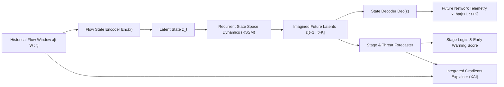

<div align="center">

# 🛡️ AI-Based Network Attack Forecasting from Network Traffic Data
### A Deep Learning World Model for Proactive Threat Progression Prediction & Explainable AI (XAI)

[](https://www.python.org/downloads/)
[](https://pytorch.org/)
[](https://fastapi.tiangolo.com/)
[](https://opensource.org/licenses/MIT)
[]()
[]()

</div>

---

## 📌 Table of Contents
- [Overview & Motivation](#-overview--motivation)
- [System Architecture](#-system-architecture)
- [Interactive Web Dashboard](#-interactive-web-dashboard)
- [Cyber Kill Chain Stages & Features](#-cyber-kill-chain-stages--features)
- [Benchmark Results vs. Reactive Baseline](#-benchmark-results-vs-reactive-baseline)
- [Explainable AI (XAI) Engine](#-explainable-ai-xai-engine)
- [Quickstart Guide](#-quickstart-guide)
- [Project Documentation](#-documentation--test-data)

---

## 💡 Overview & Motivation

Traditional Network Intrusion Detection Systems (NIDS) are inherently **reactive**: they detect an attack only after malicious payloads have already penetrated the perimeter ($x_t \to y_t$). 

This project formulates **Network Attack Forecasting** using a **Deep Learning World Model** ($z_{t+1:t+K} \sim P(z \mid z_{\le t})$). By modeling the transition dynamics of network traffic in a compact latent space, the system:
1. **Forecasts future network states and traffic anomalies** up to **20 seconds in advance** before critical assets are compromised.
2. **Identifies the likely Cyber Kill Chain attack stage** (*Reconnaissance $\to$ Initial Compromise $\to$ Lateral Movement $\to$ Exfiltration/Impact*).
3. **Explains contributing telemetry features** using **Integrated Gradients (XAI)** to help Security Operations Center (SOC) teams take proactive countermeasures.

---

## 🏛 System Architecture



### Core Architecture Modules:
- **`FlowStateEncoder` ($x_t \to z_t$)**: Compresses 16 continuous network flow features into a 32-D latent state representation $z_t$.
- **`LatentWorldDynamics` ($z_{\le t} \to z_{t+1:t+K}$)**: 2-layer Recurrent State Space Model (RSSM/GRU) rolling out transitions in latent space without raw packet simulation overhead.
- **`FlowStateDecoder` ($z_{t+k} \to \hat{x}_{t+k}$)**: Reconstructs expected future network telemetry, anchoring the latent space to authentic network behavior.
- **`AttackStageForecaster`**: Predicts multi-step attack progression and computes a continuous threat probability score for early warnings.
- **`IntegratedGradientsExplainer`**: Accumulates path integrals of gradients to calculate exact percentage attribution for every alert.

---

## 🖥️ Interactive Web Dashboard

The project includes an **Enterprise SOC Web Platform** powered by FastAPI, HTML5, Tailwind CSS, and Chart.js:

```bash
python run_dashboard.py
```
*(Automatically opens your browser to `http://localhost:5000`)*

### Platform Capabilities:
- **Real-Time Threat Radar:** Live streaming network traffic analysis and multi-horizon transition prediction.
- **Advance +20s Early Warnings:** Anticipates cyber attacks up to 20 seconds before breach execution.
- **Integrated Gradients (XAI):** Real-time breakdown of the top telemetry clues responsible for alerts.
- **Interactive Network Node Map:** Visual display of active internal assets, gateways, and threat vectors.
- **Custom CSV Telemetry Ingestion:** Drag-and-drop or browse custom network flow captures (.CSV) for immediate analysis.
- **Incident Playbook & 1-Click Lockdown:** Recommended security playbooks and automated firewall host blocking.

---

## 📊 Benchmark Results vs. Reactive Baseline

| Metric | Traditional Reactive LSTM-IDS | **Proposed World Model (Ours)** |
| :--- | :---: | :---: |
| **Operational Mode** | Reactive (post-facto) | **Proactive (Forecasting)** |
| **Advance Early-Warning Lead Time** | 0 Seconds | **Up to +20 Seconds Ahead** |
| **Future State Forecasting** | Unsupported | **Supported ($\hat{x}_{t+1:t+K}$)** |
| **Telemetry Reconstruction MSE** | N/A | **0.004786** |
| **Accuracy @ $t+1$ (+5s ahead)** | N/A | **98.78%** |
| **Accuracy @ $t+2$ (+10s ahead)** | N/A | **98.40%** |
| **Accuracy @ $t+3$ (+15s ahead)** | N/A | **97.71%** |
| **Accuracy @ $t+4$ (+20s ahead)** | N/A | **97.33%** |
| **Overall Classification F1-Score** | 0.9580 | **0.9660** |
| **Explainable AI (XAI)** | Blackbox | **Integrated Gradients** |

---

## 🔍 Explainable AI (XAI) Engine

When an alert is projected, the system computes feature attributions using **Integrated Gradients**:

$$\text{Attribution}_i = (x_i - x'_i) \times \int_{0}^{1} \frac{\partial F(x' + \alpha (x - x'))}{\partial x_i} d\alpha$$

### Sample Output:
```text
[ALERT] PROACTIVE EARLY WARNING @ t=225s
  Current Status:    Reconnaissance (Probe)
  Forecasted Stage:  Initial Compromise (in +20s ahead)
  Threat Confidence: 100.0%

[XAI] Threat Forecasting Analysis for Predicted Stage: [Initial Compromise]
Key Influential Network Telemetry Signatures:
  1. byte_ratio_fwd_bwd: 22.99% influence
  2. dst_port_entropy: 15.75% influence
  3. failed_conn_ratio: 15.55% influence
  [ACTION] Proactive Recommendation: Exploit/Auth surge predicted. 
           Inspect target service logs and isolate vulnerable endpoint.
```

---

## 🚀 Quickstart Guide

### 1. Clone & Install
```bash
git clone https://github.com/your-username/network-attack-forecasting-world-model.git
cd network-attack-forecasting-world-model
pip install -r requirements.txt
```

### 2. Launch the Web Platform
```bash
python run_dashboard.py
```
*(Starts the server and automatically opens http://localhost:5000 in your browser)*

### 3. Test Attack Prediction (Terminal Demo)
```bash
python test_prediction.py
```

### 4. Evaluate Multi-Horizon Accuracy & Metrics
```bash
python evaluate_model.py
```

### 5. Benchmark Comparison Against Reactive Baseline
```bash
python compare_models.py
```

### 6. Train / Re-Train Model
```bash
python train_model.py
```

---

## 📑 Documentation & Test Data

- **Comprehensive Project Report:** [`docs/Project_Report.md`](docs/Project_Report.md)
- **Sample Test Datasets:** [`sample_test_data/`](sample_test_data/)

---

## 📄 License
This project is licensed under the [MIT License](LICENSE).
