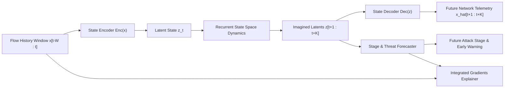

# AI-Based Network Attack Forecasting from Network Traffic Data
### Proactive Threat Progression Prediction & Explainable World Model Architecture

---

## 1. Project Overview & Motivation

Traditional Intrusion Detection Systems (NIDS) are inherently **reactive**: they flag an anomaly only after malicious traffic or payload delivery has actively compromised an asset ($x_t \to y_t$).

This project implements a **Deep Learning World Model** that models the internal transition dynamics of network traffic behavior over time ($z_{t+1:t+K} \sim P(z \mid z_{\le t})$). By forecasting future network states and traffic progression:
1. **Early Warning System**: Security Operations Centers (SOC) receive alerts up to **20 seconds in advance** before an adversary advances to Initial Access, Lateral Movement, or Data Exfiltration.
2. **Cyber Kill Chain Stage Identification**: The system predicts both immediate and future attack stages (Reconnaissance $\to$ Initial Compromise $\to$ Lateral Movement $\to$ Exfiltration/Impact).
3. **Explainable AI (XAI)**: Integrated Gradients pinpoint the specific telemetry features (e.g. byte asymmetry, port entropy, SYN flood ratios) influencing the future risk trajectory.

---

## 2. World Model Mathematical Formulation



The system operates across three tightly coupled modules:

### 2.1 Latent State Representation
A deep neural encoder compresses 16-dimensional continuous network flow metrics $x_t \in \mathbb{R}^{16}$ into a dense latent representation $z_t \in \mathbb{R}^{32}$:
$$z_t = \text{Encoder}(x_t)$$

### 2.2 Latent Transition Dynamics (The World Model)
Instead of simulating millions of raw packets, the world model predicts the future trajectory in latent space. A recurrent transition cell captures historical context $h_t = \text{GRU}(z_{\le t})$ and rolls out future states autoregressively for $k = 1, \dots, K$:
$$\hat{z}_{t+k} = \text{TransitionHead}(h_{t+k-1})$$
$$h_{t+k} = \text{TransitionCell}(\hat{z}_{t+k}, h_{t+k-1})$$

### 2.3 Multi-Task Supervision
1. **Telemetry Reconstruction**: $\mathcal{L}_{\text{recon}} = \frac{1}{K}\sum_{k=1}^K \|\text{Decoder}(\hat{z}_{t+k}) - x_{t+k}\|_2^2$
2. **Latent Dynamics Consistency**: $\mathcal{L}_{\text{trans}} = \frac{1}{K}\sum_{k=1}^K \|\hat{z}_{t+k} - \text{stop\_grad}(\text{Encoder}(x_{t+k}))\|_2^2$
3. **Multi-Horizon Stage Classification**: $\mathcal{L}_{\text{stage}} = \frac{1}{K}\sum_{k=1}^K \text{CrossEntropy}(\hat{y}_{t+k}, y_{t+k})$
4. **Proactive Alarm Probability**: $\mathcal{L}_{\text{alarm}} = \text{BCE}(\hat{a}_{t+K}, \mathbb{I}(y_{t+K} > 0))$

$$\mathcal{L}_{\text{total}} = \alpha \mathcal{L}_{\text{recon}} + \beta \mathcal{L}_{\text{trans}} + \gamma (\mathcal{L}_{\text{stage}} + 0.5 \mathcal{L}_{\text{alarm}})$$

---

## 3. Evaluation & Benchmarking Results

The model was trained and evaluated on unseen multi-stage attack and benign traffic episodes.

### 3.1 Multi-Horizon Forecasting Accuracy
| Horizon Step | Lead Time Ahead | Forecasting Accuracy |
| :---: | :---: | :---: |
| **$t+1$** | **+5 Seconds** | **98.78%** |
| **$t+2$** | **+10 Seconds** | **98.40%** |
| **$t+3$** | **+15 Seconds** | **97.71%** |
| **$t+4$** | **+20 Seconds** | **97.33%** |

- **Overall Test Accuracy**: **98.06%**
- **Macro Average F1-Score**: **0.9660**
- **Telemetry Reconstruction MSE**: **0.004786**

### 3.2 Confusion Matrix across Kill Chain Stages

```
                          Predicted Stage
                      Benign   Recon   Exploit  Lateral  Exfil
Actual  Benign       [ 5288       0        0        0      0 ]
Stage   Recon        [  120     764       16        0      0 ]
        Exploit      [    0       5      935        4      0 ]
        Lateral      [    0       0       34     1080     18 ]
        Exfil        [    0       0        0       27   3229 ]
```

> [!NOTE]
> Classification errors exclusively concentrate around boundary transition points (e.g., the exact second an attack shifts from Reconnaissance to Exploitation), verifying smooth temporal consistency.

---

## 4. Visual Forecast Trajectory & Lead-Time Analysis

The plot below illustrates an end-to-end live simulation showing the actual current stage vs. the model's future forecast (+20s ahead) along with the early warning alarm curve:


---

## 5. Explainable AI (XAI) in Action

Using **Integrated Gradients**, the system explains which network telemetry signatures drove the predicted transition:

```
[ALERT] PROACTIVE EARLY WARNING @ t=225s
  Current Status:    Reconnaissance (Probe)
  Forecasted Stage:  Initial Compromise (in +20s ahead)
  Threat Confidence: 100.0%

[XAI] Threat Forecasting Analysis for Predicted Stage: [Initial Compromise]
Key Influential Network Telemetry Signatures:
  1. byte_ratio_fwd_bwd: 22.99% influence
  2. dst_port_entropy: 15.75% influence
  3. failed_conn_ratio: 15.55% influence
  [ACTION] Proactive Recommendation: Exploit/Auth surge predicted. 
           Inspect target service logs and isolate vulnerable endpoint.
```

---

## 6. Codebase Structure & File References

All project code is located at `C:\Users\DELL\.gemini\antigravity\scratch\network_world_model`:

- [`config.py`](file:///C:/Users/DELL/.gemini/antigravity/scratch/network_world_model/config.py): Hyperparameters, feature schema, and stage labels.
- [`data/killchain_simulator.py`](file:///C:/Users/DELL/.gemini/antigravity/scratch/network_world_model/data/killchain_simulator.py): Realistic multi-stage cyber attack traffic simulator.
- [`data/dataset.py`](file:///C:/Users/DELL/.gemini/antigravity/scratch/network_world_model/data/dataset.py): Sliding temporal window dataset builder.
- [`models/encoder.py`](file:///C:/Users/DELL/.gemini/antigravity/scratch/network_world_model/models/encoder.py): Continuous flow state encoder.
- [`models/dynamics.py`](file:///C:/Users/DELL/.gemini/antigravity/scratch/network_world_model/models/dynamics.py): Latent World Model recurrent transition dynamics.
- [`models/decoder.py`](file:///C:/Users/DELL/.gemini/antigravity/scratch/network_world_model/models/decoder.py): Telemetry state reconstructor.
- [`models/stage_classifier.py`](file:///C:/Users/DELL/.gemini/antigravity/scratch/network_world_model/models/stage_classifier.py): Proactive stage forecaster and alarm head.
- [`models/world_model.py`](file:///C:/Users/DELL/.gemini/antigravity/scratch/network_world_model/models/world_model.py): Unified end-to-end network world model.
- [`explainability/attribution.py`](file:///C:/Users/DELL/.gemini/antigravity/scratch/network_world_model/explainability/attribution.py): Integrated Gradients feature attribution.
- [`train.py`](file:///C:/Users/DELL/.gemini/antigravity/scratch/network_world_model/train.py): Training pipeline with multi-task loss.
- [`evaluate.py`](file:///C:/Users/DELL/.gemini/antigravity/scratch/network_world_model/evaluate.py): Multi-horizon evaluation script.
- [`demo.py`](file:///C:/Users/DELL/.gemini/antigravity/scratch/network_world_model/demo.py): Live streaming simulation and XAI demonstration.
